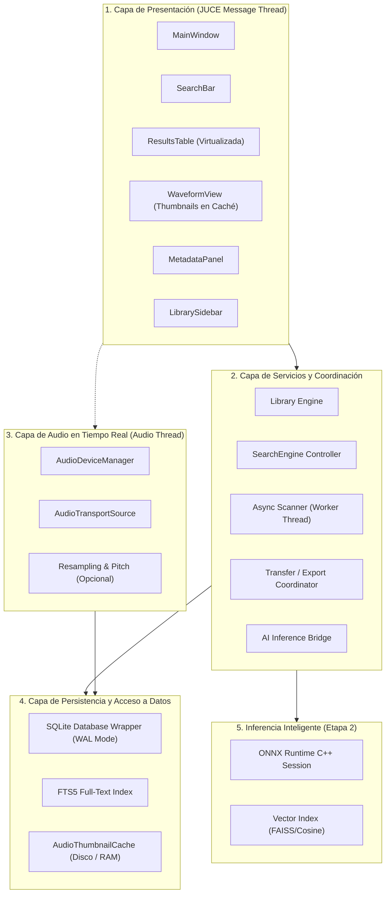
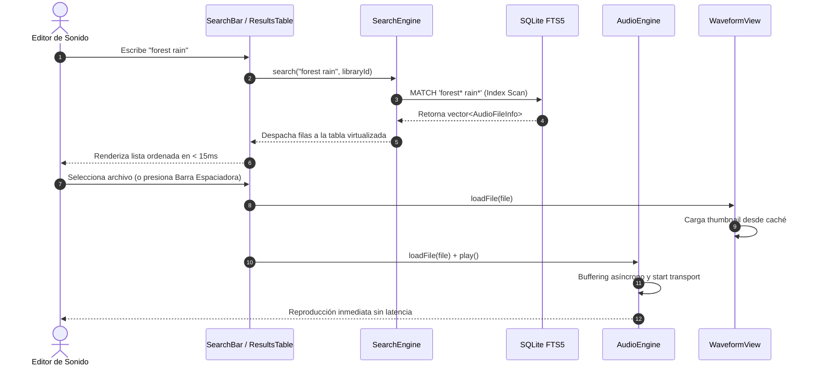

# 🏛️ Documento de Arquitectura de Software — Librairy

## 1. Introducción y Objetivos de Diseño

**Librairy** está diseñado como una aplicación de escritorio nativa para estaciones de trabajo de audio digital (DAWs), donde los requisitos de rendimiento, latencia y robustez son estrictos:

1. **Latencia Cero en la Interfaz de Usuario**: Ninguna operación de E/S de disco, escaneo de bibliotecas o consulta de base de datos puede ejecutarse en el Message Thread (hilo principal de UI).
2. **Audio Glitch-Free**: El hilo de audio en tiempo real (`AudioDeviceCallback`) opera de forma aislada y no realiza bloqueos (`locks`), reservas de memoria en el heap (`malloc`/`free`) ni llamadas al sistema operativo de E/S.
3. **Escalabilidad de Catálogo**: Capacidad de gestionar catálogos de **500,000+ archivos de audio** con tiempos de respuesta en búsquedas de texto menores a **50 ms**.
4. **Preservación Estricta de Datos**: La manipulación de metadatos (BWF/iXML) nunca debe re-codificar los datos PCM de audio, previniendo cualquier pérdida generacional o alteración de fase.
5. **Agnosticismo de Plataforma**: Diseñado en C++20 sobre JUCE 8, permitiendo compilación nativa en macOS (Universal Binary Apple Silicon & Intel) y Windows (x64).

---

## 2. Vista Arquitectónica en Capas

---

## 3. Modelo de Hilos y Concurrencia

La arquitectura define roles estrictos para evitar contenciones y condiciones de carrera:

| Hilo / Pool | Prioridad | Responsabilidades | Restricciones |
|---|---|---|---|
| **JUCE Message Thread** | Normal / Interactiva | Renderizado gráfico, procesamiento de eventos de mouse/teclado, dispatching de comandos. | Prohibido hacer I/O sincrónico, consultas DB complejas o llamadas de red. |
| **Audio Thread** | Tiempo Real (CoreAudio / WASAPI) | Relleno de buffers de audio PCM (`audioDeviceIOCallback`). | **Real-Time Safe**: Prohibido `new`/`delete`, `mutex.lock()`, llamadas a SQLite o apertura de archivos. |
| **Scanner Thread** | Background / Baja | Recorrido recursivo de carpetas, lectura de headers BWF/iXML y cálculo de hashes. | Escribe en SQLite en lotes dentro de transacciones controladas. |
| **DB / Search Worker** | Normal / Asíncrono | Ejecución de queries FTS5 complejas y filtrado de metadatos para poblar la vista. | Despacha los resultados al hilo UI mediante callbacks o `MessageManager::callAsync`. |
| **AI Inference Thread** | Media / Background | Procesamiento de lotes de audio para auto-etiquetado y extracción de embeddings con ONNX. | No debe saturar todos los núcleos de CPU para mantener fluido el DAW anfitrión. |

### Diagrama de Secuencia: Búsqueda y Previsualización

---

## 4. Diseño de Componentes Principales

### 4.1. `Database` & `SearchEngine`
- **SQLite en modo WAL (`Write-Ahead Logging`)**: Permite lectores concurrentes simultáneos mientras el escáner de fondo escribe nuevos registros sin bloquear las lecturas de la UI.
- **Virtual Table FTS5**: Tokenizador configurado en `unicode61` con `remove_diacritics 2` y `porter stemmer`, permitiendo búsquedas insensibles a mayúsculas, minúsculas, tildes y variaciones morfológicas en inglés/español.
- **Paginación & Virtualización**: La `ResultsTable` implementa el patrón virtualizado `juce::TableListBoxModel`, lo que significa que solo se crean componentes visuales para las filas visibles en pantalla (generalmente 30-40 filas), sin importar si el resultado tiene 100,000 archivos.

### 4.2. `MetadataReader` & `MetadataWriter`
- **Mapeo de Chunks BWF/iXML**: Se leen los chunks nativos `bext` (Broadcast Audio Extension) para campos industriales como `Originator`, `OriginationDate`, `TimeReference` (timecode) y el chunk XML `iXML` para taxonomía sonora (Category, Subcategory, Scene, Take, Notes).
- **Escritura Segura (Safe Atomic Write)**: La actualización de metadatos utiliza un archivo temporal (`_tmp`) para reensamblar los encabezados y copiar los bloques de datos PCM antes de realizar un `atomic rename`, garantizando que un corte de energía o fallo nunca corrompa el archivo original del usuario.

### 4.3. `AudioEngine`
- Diseñado sobre la infraestructura de bajo nivel de JUCE (`AudioDeviceManager` + `AudioTransportSource`).
- Dispone de control dinámico de volumen con curvas perceptuales logarítmicas, selección de interfaz física de salida (stereo o multicanal para configuraciones de estudio 5.1/7.1.4) y cálculo de posición normalizada para sincronización visual con la forma de onda.

### 4.4. `FileExporter` y Transferencia DAW
- Diseñado para transferencias instantáneas mediante:
  1. **Direct Drag & Drop**: Implementación de `juce::DragAndDropContainer` que expone URLs de archivos nativos del sistema operativo hacia el timeline de Pro Tools o cualquier explorador.
  2. **Estructuración UCS**: Reorganización automática de archivos en carpetas según el estándar internacional *Universal Category System* (`{Category}/{Subcategory}/{FileName}`).
  3. **Generación AAF (Roadmap)**: Exportación de listas de tomas agrupadas en tracks de sesión.

### 4.5. `AI Bridge` (Etapa 2)
- El subsistema `src/ai/InferenceEngine` aísla el runtime de C++ de Python.
- Los modelos entrenados en PyTorch se exportan con Open Neural Network Exchange (`.onnx`) y se ejecutan usando la API en C++ de **ONNX Runtime** con soporte de aceleración por hardware (CoreML en macOS, DirectML en Windows).

---

## 5. Manejo de Errores y Resiliencia

- **Archivos Huérfanos o Desconectados**: Cuando un disco externo se expulsa, el escáner y la base de datos marcan los archivos con la bandera `is_missing = 1` en lugar de eliminarlos, preservando metadatos y etiquetas personalizadas hasta que la unidad vuelva a conectarse.
- **Recuperación ante Caídas**: Al utilizar SQLite con journaling WAL y transacciones explícitas, la base de datos se recupera automáticamente sin corrupción tras cualquier cierre anómalo del sistema.
- **Validación de Archivos de Audio Dañados**: Los encabezados de archivos corruptos son atrapados en bloques controlados `try/catch` dentro del `Scanner`, incrementando el contador de errores e informando al usuario en el informe final sin detener la indexación del resto de la biblioteca.

