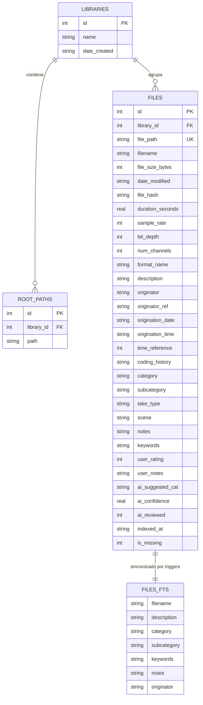

# 🗄️ Esquema de Base de Datos y Motor FTS5 — Librairy

## 1. Visión General

**Librairy** utiliza **SQLite 3** embebido como motor relacional y de búsqueda de texto completo. La base de datos almacena el catálogo completo de archivos, sus propiedades acústicas (frecuencia de muestreo, canales, duración), metadatos estándar de la industria (BWF, iXML, ID3) y sugerencias generadas por modelos de Deep Learning.

### Características Clave de Configuración
Para garantizar un rendimiento óptimo con cientos de miles de pistas de audio, la conexión se inicializa con las siguientes directivas `PRAGMA`:

```sql
PRAGMA journal_mode = WAL;          -- Permite lecturas concurrentes sin bloquear escrituras
PRAGMA synchronous = NORMAL;         -- Equilibrio óptimo entre integridad de datos y velocidad E/S
PRAGMA foreign_keys = ON;            -- Mantenimiento estricto de integridad referencial
PRAGMA cache_size = -64000;          -- Asignación de 64 MB de caché en RAM para páginas SQLite
PRAGMA temp_store = MEMORY;          -- Almacenamiento de tablas temporales en RAM
```

---

## 2. Diagrama Entidad-Relación



---

## 3. Definición DDL de Tablas

### 3.1. Tabla `libraries`
Define colecciones lógicas de sonido creadas por el usuario (ej. *"SFX Producción"*, *"Ambientes Sonoros 96k"*, *"Librería Personal H4n"*).

```sql
CREATE TABLE IF NOT EXISTS libraries (
    id           INTEGER PRIMARY KEY AUTOINCREMENT,
    name         TEXT NOT NULL,
    date_created TEXT DEFAULT (datetime('now'))
);
```

### 3.2. Tabla `root_paths`
Registra las carpetas raíz en disco asignadas a una biblioteca específica. Soporta múltiples discos y volúmenes montados.

```sql
CREATE TABLE IF NOT EXISTS root_paths (
    id         INTEGER PRIMARY KEY AUTOINCREMENT,
    library_id INTEGER NOT NULL,
    path       TEXT NOT NULL,
    FOREIGN KEY (library_id) REFERENCES libraries(id) ON DELETE CASCADE,
    UNIQUE(library_id, path)
);
```

### 3.3. Tabla `files`
Almacena todos los atributos técnicos y descriptivos de cada archivo de audio.

```sql
CREATE TABLE IF NOT EXISTS files (
    id                INTEGER PRIMARY KEY AUTOINCREMENT,
    library_id        INTEGER NOT NULL,
    file_path         TEXT NOT NULL UNIQUE,
    filename          TEXT NOT NULL,
    file_size_bytes   INTEGER DEFAULT 0,
    date_modified     TEXT,
    file_hash         TEXT,

    -- Parámetros acústicos / técnicos
    duration_seconds  REAL DEFAULT 0.0,
    sample_rate       INTEGER DEFAULT 0,
    bit_depth         INTEGER DEFAULT 0,
    num_channels      INTEGER DEFAULT 0,
    format_name       TEXT,

    -- Metadatos Broadcast Wave Format (BWF / bext chunk)
    description       TEXT DEFAULT '',
    originator        TEXT DEFAULT '',
    originator_ref    TEXT DEFAULT '',
    origination_date  TEXT DEFAULT '',
    origination_time  TEXT DEFAULT '',
    time_reference    INTEGER DEFAULT 0,
    coding_history    TEXT DEFAULT '',

    -- Metadatos iXML y Taxonomía UCS
    category          TEXT DEFAULT '',
    subcategory       TEXT DEFAULT '',
    take_type         TEXT DEFAULT '',
    scene             TEXT DEFAULT '',
    notes             TEXT DEFAULT '',
    keywords          TEXT DEFAULT '',

    -- Campos personalizados del editor
    user_rating       INTEGER DEFAULT 0,
    user_notes        TEXT DEFAULT '',

    -- Metadatos de Deep Learning (Etapa 2)
    ai_suggested_cat  TEXT DEFAULT '',
    ai_confidence     REAL DEFAULT 0.0,
    ai_reviewed       INTEGER DEFAULT 0,

    -- Banderas de auditoría e integridad
    indexed_at        TEXT DEFAULT (datetime('now')),
    is_missing        INTEGER DEFAULT 0,

    FOREIGN KEY (library_id) REFERENCES libraries(id) ON DELETE CASCADE
);
```

### 3.4. Índices B-Tree
Optimizan consultas de filtrado común y ordenamiento en la interfaz gráfica:

```sql
CREATE INDEX IF NOT EXISTS idx_files_library     ON files(library_id);
CREATE INDEX IF NOT EXISTS idx_files_category    ON files(category);
CREATE INDEX IF NOT EXISTS idx_files_format      ON files(format_name);
CREATE INDEX IF NOT EXISTS idx_files_sample_rate ON files(sample_rate);
CREATE INDEX IF NOT EXISTS idx_files_channels    ON files(num_channels);
CREATE INDEX IF NOT EXISTS idx_files_duration    ON files(duration_seconds);
CREATE INDEX IF NOT EXISTS idx_files_missing     ON files(is_missing);
```

---

## 4. Motor de Búsqueda Full-Text (FTS5)

Para obtener resultados instantáneos mientras el editor teclea en la barra de búsqueda, se emplea una tabla virtual `FTS5` respaldada como contenido externo (`content='files'`) para minimizar la duplicación innecesaria de espacio en disco.

### 4.1. Creación de la Tabla Virtual
```sql
CREATE VIRTUAL TABLE IF NOT EXISTS files_fts USING fts5(
    filename,
    description,
    category,
    subcategory,
    keywords,
    notes,
    originator,
    content='files',
    content_rowid='id',
    tokenize='porter unicode61 remove_diacritics 2'
);
```

- **`porter`**: Permite lematización en inglés (ej. buscando *"rains"* encuentra *"raining"* y *"rain"*).
- **`unicode61 remove_diacritics 2`**: Elimina acentos y tildes en búsquedas en español (ej. *"río"* encuentra *"rio"* y viceversa).

### 4.2. Sincronización Automática con Triggers
Los siguientes triggers mantienen la tabla virtual en perfecta sincronía con cualquier inserción, actualización o eliminación:

```sql
-- Trigger al Insertar
CREATE TRIGGER IF NOT EXISTS files_ai AFTER INSERT ON files BEGIN
    INSERT INTO files_fts(rowid, filename, description, category,
                          subcategory, keywords, notes, originator)
    VALUES (new.id, new.filename, new.description, new.category,
            new.subcategory, new.keywords, new.notes, new.originator);
END;

-- Trigger al Eliminar
CREATE TRIGGER IF NOT EXISTS files_ad AFTER DELETE ON files BEGIN
    INSERT INTO files_fts(files_fts, rowid, filename, description,
                          category, subcategory, keywords, notes,
                          originator)
    VALUES ('delete', old.id, old.filename, old.description,
            old.category, old.subcategory, old.keywords, old.notes,
            old.originator);
END;

-- Trigger al Actualizar
CREATE TRIGGER IF NOT EXISTS files_au AFTER UPDATE ON files BEGIN
    INSERT INTO files_fts(files_fts, rowid, filename, description,
                          category, subcategory, keywords, notes,
                          originator)
    VALUES ('delete', old.id, old.filename, old.description,
            old.category, old.subcategory, old.keywords, old.notes,
            old.originator);
    INSERT INTO files_fts(rowid, filename, description, category,
                          subcategory, keywords, notes, originator)
    VALUES (new.id, new.filename, new.description, new.category,
            new.subcategory, new.keywords, new.notes, new.originator);
END;
```

---

## 5. Patrones de Consulta Comunes

### Búsqueda de Texto con Prefijo y Relevancia (Rank)
Permite buscar términos coincidentes mientras el usuario escribe:

```sql
SELECT f.*
FROM files f
JOIN files_fts fts ON f.id = fts.rowid
WHERE files_fts MATCH 'river* water*'
  AND f.library_id = ?
  AND f.is_missing = 0
ORDER BY rank
LIMIT 200;
```

### Búsqueda Filtrada Multifactorial
Combinación de búsqueda libre con selectores técnicos (ej. sólo archivos estéreo a 96kHz o superior):

```sql
SELECT f.*
FROM files f
JOIN files_fts fts ON f.id = fts.rowid
WHERE files_fts MATCH 'explosion*'
  AND f.sample_rate >= 96000
  AND f.num_channels = 2
  AND f.format_name = 'wav'
ORDER BY f.duration_seconds DESC
LIMIT 100;
```

---

## 6. Mantenimiento y Rendimiento

1. **Compactación Periódica**:
   - `VACUUM;` reorganiza las páginas de la base de datos reduciendo la fragmentación en disco tras eliminar o mover grandes cantidades de archivos.
2. **Optimización del Índice FTS5**:
   - `INSERT INTO files_fts(files_fts) VALUES('optimize');` fusiona los árboles b-tree internos de FTS5 para optimizar las velocidades de consulta.
3. **Control de Integridad**:
   - `PRAGMA integrity_check;` ejecutado de forma transparente al abrir una biblioteca valida que no existan corrupciones en la estructura del archivo.

