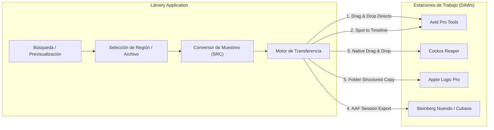
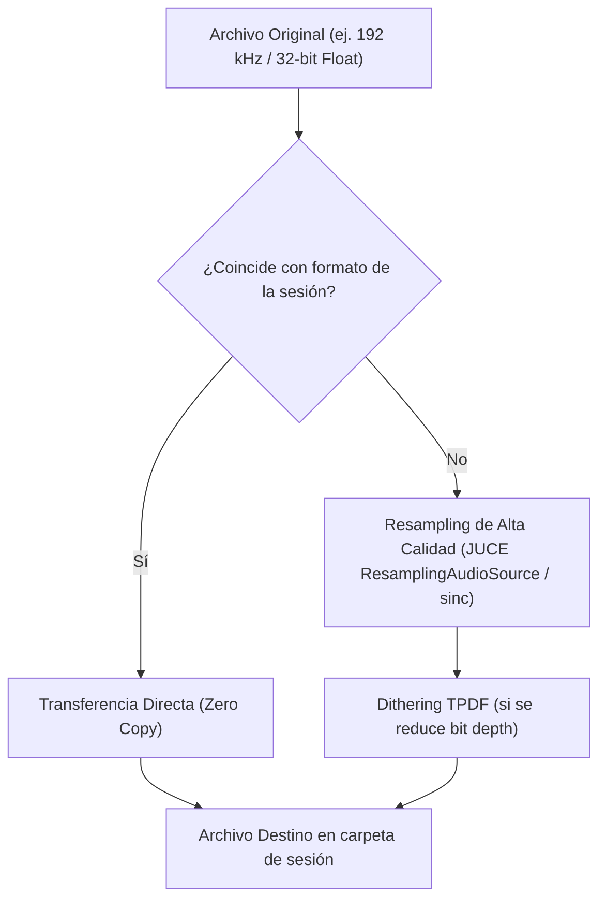

# 🎛️ Integración e Interoperabilidad con DAWs — Librairy

## 1. Visión General del Flujo de Trabajo

La función primordial de un gestor de sonido como **Librairy** (al igual que Soundminer o SoundQ) es permitir al editor encontrar el efecto o ambiente exacto y transferirlo al timeline de su estación de trabajo de audio digital (DAW) en cuestión de milisegundos.



---

## 2. Mecanismos de Transferencia

### 2.1. Drag & Drop Nativo del Sistema Operativo
Es el método más compatible y universal. Al arrastrar una o más filas desde la tabla de resultados hacia la ventana de un DAW:

- **macOS (`NSPasteboard`)**:
  - Se registra el tipo `NSPasteboardTypeFileURL` y `NSFilenamesPboardType`.
  - Pro Tools, Reaper, Logic y Studio One aceptan la lista de URLs y cargan el archivo en el track apuntado por el cursor.
- **Windows (`OLE / IDataObject`)**:
  - Se registra el portapapeles con `CF_HDROP`.
  - Permite arrastre directo a Pro Tools for Windows, Cubase y Nuendo.

### 2.2. Transferencia "Spot to Timeline" (Pro Tools)
El flujo clásico de postproducción cinematográfica donde el cursor del DAW define la posición de inserción:

1. **Protocolo AppleScript / Accessibility API (macOS)**:
   - Se consulta el Timecode actual del cabezal de Pro Tools vía la API de Accesibilidad o scripting de sesión.
   - Se copia el archivo al directorio `Audio Files` de la sesión activa de Pro Tools.
   - Se ejecuta el comando de spot (`Cmd+M` o inserción por timecode BWF `timeReference`).
2. **Uso de metadatos BWF `TimeReference`**:
   - Cuando un archivo BWF contiene la marca de tiempo de grabación original, Pro Tools permite hacer *"Spot to original timestamp"* de forma automática.

### 2.3. Integración Avanzada con REAPER
Cockos Reaper ofrece soporte extraordinario para integración externa:
- **Reaper ReaScript / Web Remote**: Comunicación vía socket local o named pipes para insertar tomas seleccionadas en el track activo en el cursor de edición.
- **Sub-projects y Region Markers**: Creación de marcadores de región con la descripción del metadato.

### 2.4. Generación de Sesiones de Intercambio (AAF / OMF)
- Para entregas complejas o conformados por lotes, **Librairy** exporta archivos **AAF (Advanced Authoring Format)** con pistas organizadas por categorías de sonido (ej. un track para `Ambience_Forest`, otro para `Foley_Footsteps`), manteniendo intactos los metadatos y referencias a los archivos WAV originales.

---

## 3. Conversión de Frecuencia de Muestreo (SRC) y Formato

Al transferir a una sesión de trabajo existente, los archivos de la librería pueden tener características dispares (ej. 96 kHz / 24-bit) que difieren del proyecto del DAW (ej. 48 kHz / 24-bit para televisión o cine):



### Reglas de Conversión
- **Algoritmo de Remuestreo**: Algoritmo interpolador Sinc de fase lineal con rechazo de alias superior a **100 dB**.
- **Dithering**: Aplicación de TPDF (Triangular Probability Density Function) al truncar de 24/32-bit a 16-bit para evitar distorsión por cuantización en pasajes de bajo nivel.
- **Normalización Opcional**: Opción para normalizar picos o LUFS integrado durante la exportación a proyectos rápidos de broadcast.

---

## 4. Estándar UCS (Universal Category System)

**Librairy** adopta de forma nativa el estándar de la industria [Universal Category System (UCS)](https://universalcategorysystem.com/), una taxonomía de nombres y categorías estandarizada a nivel mundial creada por diseñadores de sonido.

### 4.1. Estructura de Nombres de Archivo UCS
Los archivos exportados o renombrados siguen la convención:

$$\text{CatID}\_\text{FXName}\_\text{CreatorID}\_\text{SourceID}.\text{ext}$$

Ejemplo:
```text
WATRStrm_River Flow Gentle Current Close Mic_LIBRAIRY_ZOOMH6.wav
```

- **`CatID`**: Código de 8 letras que define la categoría principal y subcategoría (ej. `WATRStrm` = Water > Stream).
- **`FXName`**: Descripción legible y concisa del sonido.
- **`CreatorID`**: Diseñador de sonido, estudio o marca grabadora.
- **`SourceID`**: Proyecto, biblioteca o dispositivo de origen (ej. grabadora portátil).

### 4.2. Mapeo de Carpetas
Al utilizar la opción `FolderStructure::ByCategory` o `BySubcategory` en `FileExporter`, la jerarquía se genera de forma limpia y predecible:

```text
Export_Folder/
├── Ambience/
│   ├── Forest/
│   │   └── AMBForst_Morning Birds Chirping.wav
│   └── City/
│       └── AMBCity_Downtown Traffic Afternoon.wav
└── Water/
    └── Stream/
        └── WATRStrm_River Flow Gentle Current.wav
```

