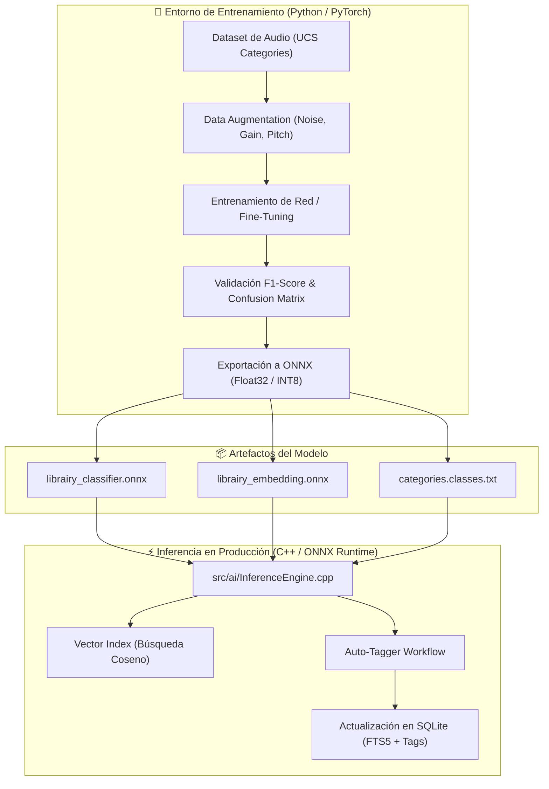

# 🧠 Pipeline de Machine Learning & Auto-Tagging — Librairy

## 1. Planteamiento del Problema

Los editores de sonido y grabadores de campo capturan continuamente gigabytes de audio en dispositivos portátiles (Zoom, Sound Devices, Tascam). Con frecuencia, estos archivos se importan a la estación de trabajo **sin metadatos descriptivos**, etiquetados únicamente como `ZOOM0001.WAV`, `ZOOM0002.WAV`, etc.

La **Etapa 2** de Librairy resuelve este cuello de botella aplicando redes neuronales profundas para:
1. **Clasificación Automática (Auto-Tagging)**: Reconocer huellas acústicas ("hojas secas", "río", "pájaros", "viento", "motor") y asignar categoría, subcategoría y etiquetas UCS automáticamente.
2. **Búsqueda por Similitud Sonora (Query by Example)**: Encontrar archivos acústicamente análogos sin depender de palabras clave coincidentes.
3. **Búsqueda Semántica de Texto a Audio (Text-to-Audio Search)**: Traducir consultas en lenguaje natural (ej. *"sonido de lluvia contra una ventana"*) al espacio de embeddings de audio usando modelos multimodales **CLAP**.

---

## 2. Flujo Completo: De Python a Inferencia Nativa en C++



---

## 3. Representación Acústica y Preprocesamiento

Para alimentar a las redes neuronales convolucionales o basadas en transformers, el audio crudo PCM se procesa en el dominio tiempo-frecuencia:

1. **Frecuencia de Muestreo Normalizada**: Se remuestrea a **$22,050\text{ Hz}$** o **$44,100\text{ Hz}$** (dependiendo del backbone).
2. **Conversión a Mono**: Promedio de canales estéreo/multicanal.
3. **Log-Mel Spectrogram**:
   - Tamaño de ventana FFT ($N_{\text{fft}}$): 2048 muestras.
   - Longitud de salto (*hop length*): 512 muestras.
   - Número de filtros Mel ($N_{\text{mels}}$): 128 bandas.
   - Escala logarítmica: Amplitud a decibelios ($dB$) con umbral dinámico de $80\text{ dB}$.

---

## 4. Modelos Soportados

### 4.1. CNN Baseline (`ml/training/model.py`)
Arquitectura convolucional liviana de 4 bloques (Conv2D + BatchNorm + ReLU + MaxPool) con capa de pooling adaptativo y cabezal de clasificación:
- **Parámetros**: $\approx 4.5\text{ M}$.
- **Ventaja**: Ejecución en tiempo real con uso despreciable de CPU, ideal para laptops y equipos portátiles de edición.
- **Salida**: Logits de clasificación y vector embedding de 512 dimensiones normalizado con norma $L_2$.

### 4.2. CLAP (Contrastive Language-Audio Pretraining)
Para búsqueda semántica text-to-audio, se adopta el modelo **CLAP** (LAION-AI):
- Entrenado con millones de pares de audio y descripciones textuales.
- Proyecta texto y audio en un mismo espacio latente de embeddings.
- Permite calcular la similitud del coseno entre el texto ingresado por el editor y cualquier clip de audio de la biblioteca:

$$\text{Similitud}(T, A) = \frac{\mathbf{e}_{\text{texto}} \cdot \mathbf{e}_{\text{audio}}}{\|\mathbf{e}_{\text{texto}}\| \|\mathbf{e}_{\text{audio}}\|}$$

---

## 5. Taxonomía Sonora y Entrenamiento

La taxonomía está definida en [`ml/taxonomy/categories.yaml`](../ml/taxonomy/categories.yaml) y comprende:
- **Ambience** (Forest, City, Rain, Wind, River, Sea, Interior)
- **Foley** (Footsteps, Cloth, Doors, Glass, Wood, Metal)
- **Impacts & Explosions**
- **Vehicles & Mechanical**
- **Nature & Wildlife**
- **Human Actions & Reactions**

### 5.1. Ejecución del Entrenamiento
```bash
python -m training.train \
    --data_dir /datos/audios_clasificados \
    --output_dir ./checkpoints \
    --epochs 60 \
    --batch_size 32 \
    --lr 0.001 \
    --sample_rate 22050 \
    --duration 5.0
```

### 5.2. Técnicas de Aumento de Datos (*Data Augmentation*)
- **Random Gain**: Variación aleatoria de ganancia entre $-6\text{ dB}$ y $+6\text{ dB}$.
- **Gaussian Noise**: Adición leve de ruido blanco para evitar sobreajuste en pistas limpias de estudio.
- **Random Crop**: Recorte aleatorio en clips largos durante el entrenamiento para capturar distintos momentos dinámicos del evento sonoro.

---

## 6. Exportación y Validación ONNX

El script `ml/training/export_onnx.py` se encarga de empaquetar el grafo computacional para su consumo directo en C++:

```bash
python -m training.export_onnx \
    --checkpoint ./checkpoints/best_model.pt \
    --output ../models/librairy_classifier.onnx
```

### Controles de Calidad al Exportar
1. **Verificación de Grafo**: `onnx.checker.check_model` valida que todas las operaciones correspondan al estándar Open Neural Network Exchange.
2. **Validación Numérica Cruzada**: Se evalúa un tensor aleatorio a través de PyTorch y ONNX Runtime, exigiendo una discrepancia máxima inferior a $10^{-4}$:
   $$\max |\mathbf{y}_{\text{PyTorch}} - \mathbf{y}_{\text{ONNX}}| < 10^{-4}$$
3. **Doble Grafo**:
   - `librairy_classifier.onnx`: Emite probabilidades por categoría para sugerencias de etiquetado.
   - `librairy_classifier_embedding.onnx`: Emite directamente el vector latente $L_2$ normalizado para indexación y búsqueda por similitud.

---

## 7. Integración en C++ (`src/ai/`)

En la aplicación compilada, `librairy::InferenceEngine`:
1. Inicializa un entorno `Ort::Env` y `Ort::Session` con hilos dedicados.
2. Preprocesa el archivo de audio usando las funciones de lectura de `MetadataReader`.
3. Ejecuta la sesión de inferencia en segundo plano sin interrumpir la reproducción de audio ni el refresco de la pantalla.
4. Escribe las sugerencias (`ai_suggested_cat`, `ai_confidence`) en la base de datos SQLite y emite un evento a la interfaz para que el editor pueda aceptar o corregir la etiqueta con un solo clic.

